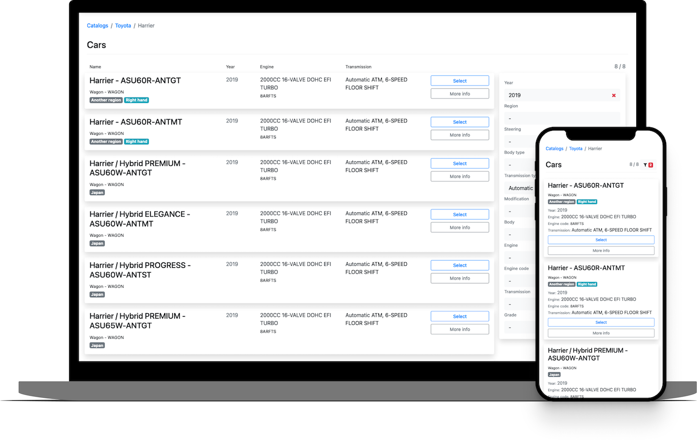

# Descargo de responsabilidad

Este proyecto se proporciona "tal cual", sin garantía de ningún tipo, expresa o implícita, 
incluidas, entre otras, las garantías de comerciabilidad, idoneidad para un fin particular 
y no infracción. En ningún caso los autores o los titulares de los derechos de autor serán responsables de ninguna reclamación, 
daño u otra responsabilidad, ya sea en una acción contractual, extracontractual o de otra índole, que surja de, 
por o en relación con el software o el uso u otros tratos con el software.

Los autores no asumen responsabilidad por errores u omisiones en la información o el código proporcionado, 
ni garantizan su funcionalidad o resultados. Use este código bajo su propio riesgo y criterio.

Se aceptan contribuciones al proyecto; sin embargo, los autores se reservan el derecho de no implementar cambios o 
sugerencias que no se alineen con los objetivos o estándares del proyecto.

# Cliente de Catálogos de Piezas

Cliente sencillo para api.parts-catalogs.com basado en el framework PHP Slim.



## Instalación

1. Clona este repositorio
1. Inserte su clave API en [src/settings.php](src/settings.php)
```php
'partsCatalogs' => [
    'apiKey' => 'YOUR_API_KEY_HERE',
]
```
1. Ejecute en Docker
   ```docker compose --profile dev up```
1. Abra en el navegador http://127.0.0.1:8080
